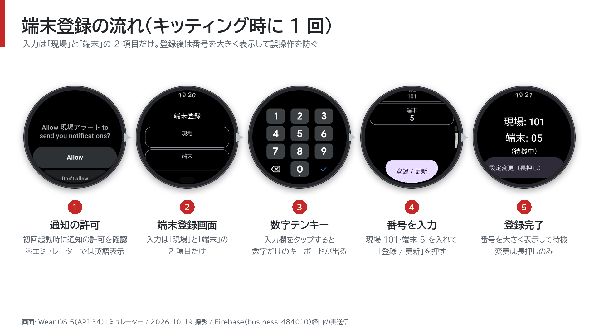
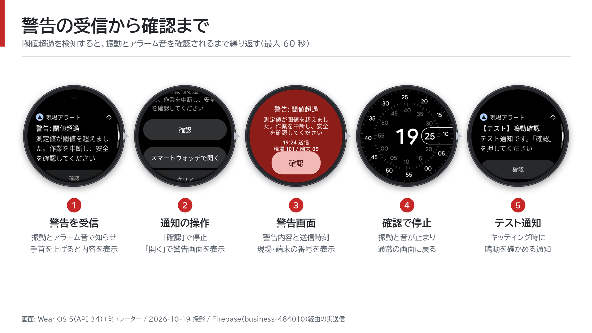
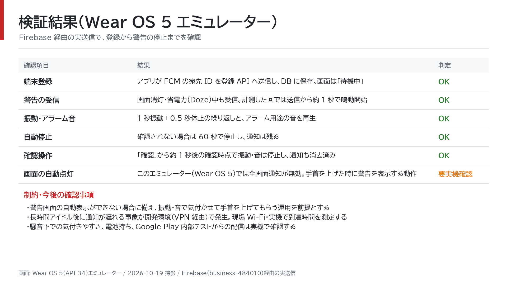

# 現場アラート — Wear OS スマートウォッチ通知システム

監視システムが測定値の閾値超過を検知したら、現場の作業員の手首へ警告を届けます。Wear OS の時計が振動とアラーム音で知らせ、作業員は通知の内容を見て「確認」を押します。

**現在は試作・検証段階です。** Wear OS 5 エミュレーターで登録から通知の停止までを確認済みです。実機・現場での検証、既存の監視システムへの組み込み、Google Play からの配信はこれから行います。

- **時計だけで受信**: スマホとの連動や SIM は不要。インターネットに接続できる現場 Wi-Fi を使います。
- **現場ごとに一斉通知**: 対象の現場に登録された時計すべてへ警告を送ります。
- **設定は番号を 2 つ入力**: 現場番号と端末番号を登録すると、待機画面に大きく表示します。
- **気付いたら「確認」**: 振動と音を停止できます。操作がない場合も最大 60 秒で鳴動を停止し、通知は残ります。

説明資料: [PDF を見る](docs/presentation/sitealert_poc_report.pdf) · [PowerPoint をダウンロード](docs/presentation/sitealert_poc_report.pptx) · [画面画像一覧](docs/screenshots/README.md)

## 時計の使い方

### 1. 通知を許可し、現場番号と端末番号を登録する



1. アプリを起動し、通知を許可します（画像の許可画面はエミュレーターのため英語です）。
2. 管理者から指定された「現場」と「端末」の番号を入力します。入力欄を押すと数字のテンキーが開きます。
3. 「登録 / 更新」を押し、番号と「（待機中）」が表示されたことを確認します。「（未同期）」の場合は、Wi-Fi や登録 API への接続を確認してください。
4. 配布前に、管理者からテスト通知を送り、時計が鳴ることと「確認」で止まることを確かめます。

番号を変更する時は「設定変更」を長押しします。「同じ番号の時計あり」と表示された時は貸し出し台帳を確認してください。同じ番号でも別の時計の登録を上書きしないため、両方の時計が通知対象に残ります。

### 2. 警告を受け取り、内容を確認する



1. 警告を受信すると、振動とアラーム音を繰り返します（最大 60 秒）。
2. 手首を上げて通知を読みます。「スマートウォッチで開く」を押すと、警告内容・送信時刻・現場と端末の番号を表示します。
3. 通知または警告画面の「確認」を押すと、振動と音が止まり、通知が消えます。

「確認」は時計の鳴動を止める操作です。現場では警告の内容に従って対応してください。Wear OS 5 エミュレーターでは、受信時に警告画面を自動で全画面表示できず、手首を上げて内容を見る動作を確認しています。

## 確認できていること・これから確かめること



画像は 2026-10-19 に Wear OS 5（API 34）エミュレーターで撮影しました。Firebase 経由の実送信で、登録・受信・鳴動・60 秒での停止・「確認」での停止を確かめています。省電力状態で送信から約 1 秒で鳴動した計測例もありますが、現場での到達時間を保証するものではありません。

実機では、長時間待機後の受信、Wi-Fi の維持、警告の表示、騒音下での気付きやすさ、電池持ちを確認する必要があります。詳細は [検証記録](docs/05-implementation-plan.md#31-エミュレーターでの結果2026-10-19) と [リスク・未決事項](docs/06-risks-and-open-issues.md) を参照してください。

## 導入に必要なもの

| 用意するもの | 役割・状態 |
| --- | --- |
| Wear OS 4 以降のスマートウォッチ | 作業員が装着する受信端末。対象機種は未選定です |
| インターネットに接続できる現場 Wi-Fi | 時計から登録 API と Firebase へ接続します |
| Firebase プロジェクト | Firebase Cloud Messaging（FCM）で警告を配信します |
| 登録 API と端末台帳 | どの時計がどの現場にいるかを管理します。本リポジトリに参考実装があります |
| 既存の監視システムとの接続 | 閾値超過を検知した時に通知送信処理を呼び出します。組み込みは未実施です |
| Google Play Console | 内部テストによるアプリの配布・更新を予定しています。現在は未配信です |

初期設定・配布・日々の運用は [提供・運用手順書](docs/04-operations-runbook.md) にまとめています。

## 開発環境で試す

前提: Python 3.12、JDK 17、Android SDK（platform 37）、Wear OS エミュレーターまたは実機、Firebase プロジェクト。以下の各手順はリポジトリのルートから実行します。実機での接続には、時計から到達できる登録 API の URL が必要です。

### 1. Firebase とローカル設定を用意する

自分の Firebase プロジェクトに Android アプリ `net.howlrs.sitealert` を登録し、その `google-services.json` を `wear-app/app/` に置きます。FCM の送信には、送信権限を持つ Application Default Credentials などの認証情報を別途用意してください（[認証と通信要件](docs/03-backend-spec.md#5-認証情報と通信要件)）。

```bash
cp backend/.env.example backend/.env
openssl rand -hex 32   # 出力した値を、次の両方の API キーに設定する
```

`backend/.env` の `SITEALERT_API_KEY` を生成した値に、`FIREBASE_PROJECT_ID` を自分のプロジェクト ID に変更します。次に `wear-app/local.properties` を作成します。

```properties
sdk.dir=/absolute/path/to/Android/Sdk
siteAlert.apiKey=backend/.envのSITEALERT_API_KEYと同じ値
# エミュレーター用の既定値。実機では到達できる URL に変更する
siteAlert.registerUrl.debug=http://10.0.2.2:8765/api/register
```

`.env`、`local.properties`、`google-services.json`、端末台帳の DB、署名鍵は Git 管理から除外しています。設定ファイルと認証情報は各自の環境に用意します。

### 2. 登録 API を起動する

```bash
cd backend
python3 -m venv .venv
.venv/bin/pip install -r requirements-dev.txt
.venv/bin/python -m pytest
set -a
. ./.env
set +a
.venv/bin/uvicorn --factory sitealert_backend.api:app_from_env --host 127.0.0.1 --port 8765
```

API はこのターミナルで起動したままにします。デバッグビルドの既定の接続先 `http://10.0.2.2:8765/api/register` は、エミュレーターからホスト上の API を呼ぶための URL です。本番の登録 API は HTTPS で公開します。

### 3. 時計アプリをビルドし、登録する

別のターミナルで、エミュレーターまたは接続した時計にインストールします。

```bash
cd wear-app
./gradlew :app:testDebugUnitTest :app:assembleDebug
adb install -r app/build/outputs/apk/debug/app-debug.apk
```

時計でアプリを開き、上の「時計の使い方」に沿って、例として現場 `101`・端末 `5` を登録します。

### 4. 管理コマンドでテスト通知を送る

別のターミナルで設定を読み込んでから実行します。送信先は自分が登録した検証用の時計にしてください。

```bash
cd backend
set -a
. ./.env
set +a
.venv/bin/python -m sitealert_backend.cli devices --site 101
.venv/bin/python -m sitealert_backend.cli send --site 101 --device 5 --type test
```

現場の全台への警告送信、登録解除、送信エラーの扱いは [バックエンド仕様書](docs/03-backend-spec.md#7-テスト送信手段補足) を参照してください。

## リポジトリの構成

| パス | 内容 |
| --- | --- |
| `wear-app/` | Wear OS アプリ（Kotlin / Jetpack Compose for Wear OS） |
| `backend/` | 登録 API・通知送信の参考実装（Python / FastAPI / SQLite）、テスト、PostgreSQL・MySQL の DDL |
| `docs/screenshots/` | 時計の画面キャプチャと、README に掲載しているスライド画像 |
| `docs/presentation/` | 説明資料（PowerPoint・PDF）と生成スクリプト |
| `docs/` | 設計、検証結果、運用、引き継ぎの資料 |
| `dev/` | 既存の開発環境向けのエミュレーター操作・送信補助。本番では使いません |

既存環境での開発再開は [引き継ぎ資料](docs/07-handoff.md) を参照してください。

## 資料一覧

| No. | 資料 | 内容 | 主な読者 |
| --- | --- | --- | --- |
| 00 | [原本: 実装ディレクション](docs/00-original-direction.md) | 受領した方針の原文。各資料の出典 | 全員 |
| 01 | [システム概要書](docs/01-system-overview.md) | 目的、全体構成、データフロー、前提条件 | 全員 |
| 02 | [Wear OS アプリ仕様書](docs/02-wearos-app-spec.md) | 画面、保存、トークン登録、通知受信、権限 | 開発者 |
| 03 | [バックエンド仕様書](docs/03-backend-spec.md) | `watch_devices` テーブル、登録 API、通知送信処理 | 開発者 |
| 04 | [提供・運用手順書](docs/04-operations-runbook.md) | 初期構築、キッティング、現場運用、障害対応 | 開発者、キッティング担当者、現場管理者 |
| 05 | [実装計画書](docs/05-implementation-plan.md) | マイルストーン、PoC 検証項目、テスト方針、実装指示プロンプト | 開発者 |
| 06 | [リスク・未決事項一覧](docs/06-risks-and-open-issues.md) | 要決定事項、技術リスク、原本内の不整合 | 全員 |
| 07 | [引き継ぎ資料](docs/07-handoff.md) | 作業終了時点の状態、次にやること、開発環境の再開手順と注意点 | 開発者 |

## 資料の表記

| 表記 | 意味 |
| --- | --- |
| （無印） | 原本の方針どおりの内容 |
| 補足 | 原本を実装・運用できる粒度にするために追加した内容。採否はレビューで確定する |
| D-xx | 要決定事項（[06 §2](docs/06-risks-and-open-issues.md#2-要決定事項)） |
| R-xx | 技術リスク・要確認事項（[06 §3](docs/06-risks-and-open-issues.md#3-技術リスク)） |
| P-xx | PoC 検証項目（[05 §3](docs/05-implementation-plan.md#3-poc-検証項目)） |
