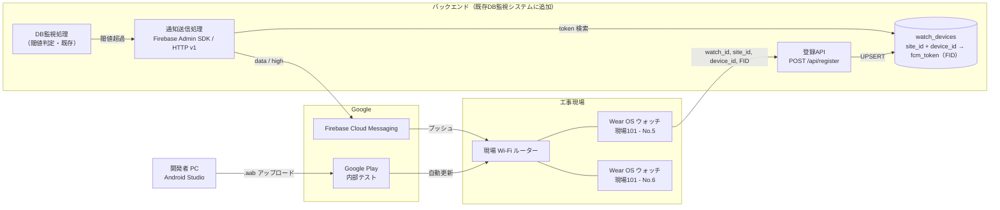
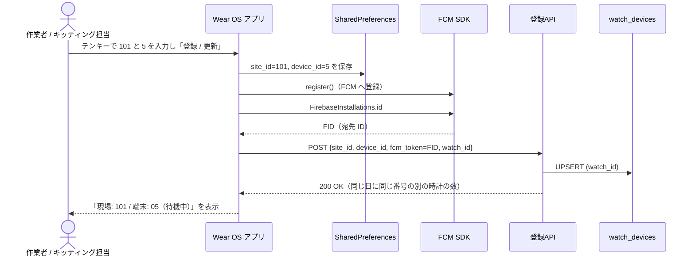
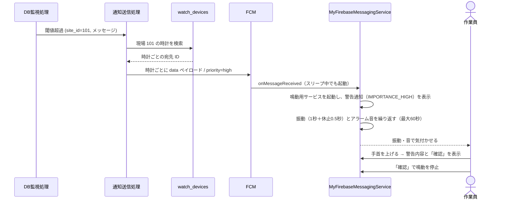

# 工事現場向け スマートウォッチ通知システム システム概要書

作成日: 2026-10-19  
バージョン: 0.3.0（現場単位の通知と時計ごとの登録。D-07、D-14）  
元資料: [00-original-direction.md](00-original-direction.md)  
対象: システム全体構成 / 構成要素 / データフロー / 前提条件

## 1. 目的

既存の DB 監視システムが閾値超過を検知した時、該当する現場の作業員が装着している Wear OS スマートウォッチへプッシュ通知を送る。騒音のある工事現場でも気づけるよう、長い振動、アラーム音、画面の強制点灯で知らせる。

本システムは既存の監視・警報の **補助的な通知手段** として位置付ける。FCM は配信を保証しないため、法令や安全規程で求められる警報設備の代わりにはしない（[06 R-03](06-risks-and-open-issues.md#3-技術リスク)）。

## 2. 基本方針

| 項目 | 方針 |
| --- | --- |
| ターゲット端末 | Wear OS スマートウォッチ。SIM なし、現場 Wi-Fi 接続、スマホと連動しない単体運用 |
| 通知基盤 | Google Firebase Cloud Messaging (FCM) |
| アプリ配信・更新基盤 | Google Play Console「内部テスト」トラック。審査なし、Wi-Fi 経由で自動更新 |
| 開発環境 | Android Studio / Kotlin / Jetpack Compose for Wear OS |
| 端末の識別 | `site_id`（現場識別子）と `device_id`（端末番号）の組で 1 台を識別する。変更（D-14）: 端末番号は作業員の申告で重なりうるため、DB では時計本体の識別子（`watch_id`、アプリが自動で送る）で 1 台を識別し、端末番号は台帳との照合と表示に使う |
| 通知の宛先 | 変更（D-07）: 現場単位。その現場に登録された時計すべてへ送る |
| UI | 入力項目は 2 つだけ。入力値は端末内に保存し、登録済みなら現在値を大きく表示する |
| 通知方式 | `notification` ではなく `data` ペイロードを優先度 `high` で送る |

## 3. システム構成

### 3.1 構成要素

| 構成要素 | 役割 | 詳細資料 |
| --- | --- | --- |
| Wear OS アプリ | `site_id` / `device_id` の入力・保存、FCM トークンの登録、通知の受信と鳴動 | [02-wearos-app-spec.md](02-wearos-app-spec.md) |
| 登録 API | ウォッチから送られた登録内容を、その時計の行（`watch_id`）に UPSERT する | [03-backend-spec.md](03-backend-spec.md) |
| `watch_devices` テーブル | 時計 1 台につき 1 行。現場番号、作業員が入力した端末番号、最新の宛先 ID の対応表 | [03-backend-spec.md](03-backend-spec.md) |
| 通知送信処理 | 閾値超過時に、その現場に登録された時計すべてへ FCM の `data` メッセージを送る | [03-backend-spec.md](03-backend-spec.md) |
| FCM | Google のプッシュ配信基盤。スリープ中の端末も高優先度メッセージで起こす | ― |
| Google Play 内部テスト | アプリの配布と自動更新 | [04-operations-runbook.md](04-operations-runbook.md) |
| 現場 Wi-Fi | ウォッチのインターネット接続経路。SIM がないため唯一の通信路になる | [04-operations-runbook.md](04-operations-runbook.md) |

## 4. 主要データフロー

### 4.1 端末登録（キッティング時・番号変更時）

端末番号は、朝会後に時計を配る時に、貸し出し台帳と照らし合わせて作業員が入力する。DB の行は時計本体の識別子（`watch_id`）ごとに持つため、番号を打ち間違えて別の時計と重なっても、先に登録した時計の行は上書きされず、どちらにも通知が届く。重なった時は、登録した時計に「同じ番号の時計あり　台帳を確認」と表示する（[06 D-14](06-risks-and-open-issues.md#2-要決定事項)）。

### 4.2 宛先 ID の再登録（アプリ起動時・ID 変更時）

FCM の宛先は Firebase Installation ID（FID）とした。原本の `FirebaseMessaging.getInstance().token`（登録トークン）は SDK で非推奨になったため（[06 R-20](06-risks-and-open-issues.md#3-技術リスク)）。FID はアプリの再インストール、データ消去、別端末への復元などで変わる。原本の方針どおりアプリ起動時に POST し直すほか、FID が変わった時に呼ばれる `onRegistered()` でも再登録し、作業員がアプリを開かなくても DB を最新に保つ（[02 §4.3](02-wearos-app-spec.md#43-送信タイミング)）。

### 4.3 アラート通知（閾値超過時）

`notification` ペイロードを使うと、アプリがバックグラウンドの時は OS が通知を表示し、`onMessageReceived` が呼ばれない。そうなると独自の振動パターンや画面点灯を実行できないため、`data` ペイロードに限定する。

## 5. 前提条件と制約

| 区分 | 内容 |
| --- | --- |
| 通信 | ウォッチは SIM を持たないため、現場 Wi-Fi が届かない場所では通知を受け取れない |
| 通信 | 現場ネットワークから FCM（TCP 5228〜5230 および 443）と登録 API へ到達できる必要がある。ログイン画面を挟む Wi-Fi（キャプティブポータル）は使えない |
| 端末 | 初期セットアップだけは設定用スマホ 1 台が必要。セットアップ後は Bluetooth を切って単体で動かす |
| 端末 | アラーム音を鳴らすにはスピーカー付きの機種が必要（[06 D-08](06-risks-and-open-issues.md#2-要決定事項)） |
| 配信 | 内部テストのテスター上限は 100 アカウント。上限を超える場合は Google アカウントの運用を見直す（[06 D-03](06-risks-and-open-issues.md#2-要決定事項)） |
| 配信 | 自動更新は Play ストアの判断で行われ、即時ではない。新旧バージョンが混在する期間がある |
| OS | Android 14 以降はフルスクリーンインテントが通話・アラーム用途に制限される。Wear OS 5 エミュレーターでは起動しないことを確認した。警告は手首を上げた時に表示される（[06 R-01](06-risks-and-open-issues.md#3-技術リスク)） |
| 安全 | FCM の到達は保証されない。補助的な通知手段として扱う |
| 通信 | バックエンドの設置先で `fcm.googleapis.com` を名前解決・到達できること。長時間の無通信で接続を切るネットワークでは警告が遅れる（[06 R-21](06-risks-and-open-issues.md#3-技術リスク)） |

## 6. 資料一覧

| No. | 資料 | 内容 |
| --- | --- | --- |
| 00 | [原本: 実装ディレクション](00-original-direction.md) | 受領した方針の原文 |
| 01 | システム概要書（本書） | 全体構成、データフロー、前提条件 |
| 02 | [Wear OS アプリ仕様書](02-wearos-app-spec.md) | 画面、保存、トークン登録、通知受信、権限 |
| 03 | [バックエンド仕様書](03-backend-spec.md) | テーブル、登録 API、通知送信処理 |
| 04 | [提供・運用手順書](04-operations-runbook.md) | 初期構築、キッティング、現場運用、障害対応 |
| 05 | [実装計画書](05-implementation-plan.md) | 作業分解、PoC 検証項目、実装指示プロンプト |
| 06 | [リスク・未決事項一覧](06-risks-and-open-issues.md) | 要決定事項、技術リスク、要確認事項 |
| ― | [画面キャプチャ・発表用画像](screenshots/README.md) | エミュレーターの画面とスライド画像 |
