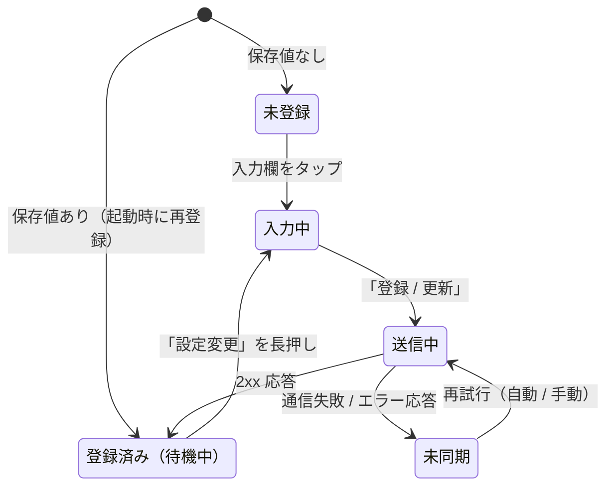
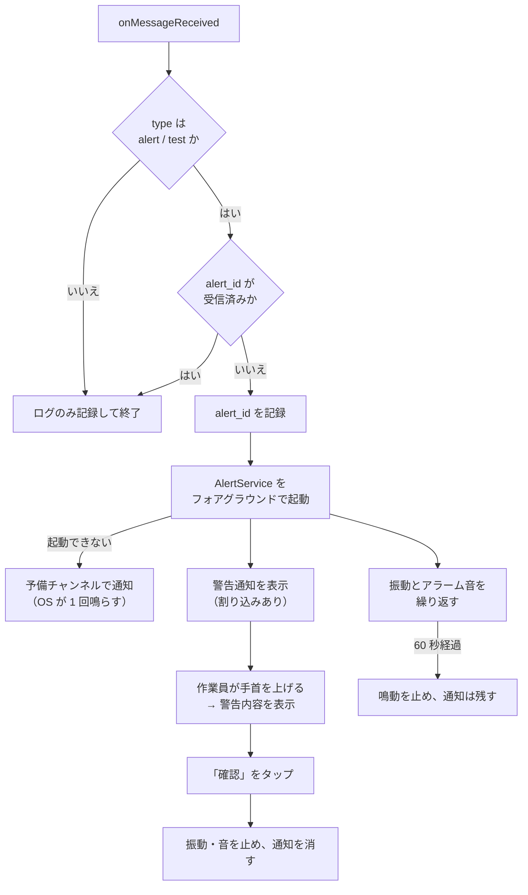

# Wear OS アプリ仕様書

作成日: 2026-10-19  
バージョン: 0.3.0（時計の識別子と番号の重複警告。D-14）  
元資料: [00-original-direction.md](00-original-direction.md) §2  
対象: Wear OS アプリ（Kotlin / Jetpack Compose for Wear OS）  
実装: [`wear-app/`](../wear-app/)  
画面: [screenshots/README.md](screenshots/README.md)

## 1. 概要

作業員が装着する Wear OS ウォッチ上で動くアプリ。主な機能は次の 3 つ。

1. `site_id`（現場識別子）と `device_id`（端末番号）を入力して端末内に保存する
2. FCM に登録し、宛先 ID を `site_id` / `device_id` と一緒にバックエンドへ登録する
3. FCM の `data` メッセージを受信したら、振動とアラーム音で作業員に知らせ、警告内容を表示する

時計の極小画面で入力ミスを防ぐため、UI は極力シンプルにし、一度入力した値は端末内に保存して使い続ける。

### 1.1 表記

| 表記 | 意味 |
| --- | --- |
| （無印） | 原本の方針どおりの仕様 |
| 補足 | 原本を実装可能な粒度にするために追加した仕様 |
| 変更 | 原本の方針から実装時に変えた仕様。理由を併記する |
| D-xx / R-xx | [06-risks-and-open-issues.md](06-risks-and-open-issues.md) の ID に対応する |

### 1.2 原本からの主な変更（実装・検証で判明）

| No. | 原本 | 実装 | 理由 |
| --- | --- | --- | --- |
| 1 | `FirebaseMessaging.getInstance().token` でトークンを取得 | `register()` で FCM に登録し、Firebase Installation ID（FID）を宛先として送る | FCM SDK 25.1.0 以降、`getToken` / `onNewToken` は非推奨（R-20） |
| 2 | 振動は 1 秒＋0.5 秒休止を 5 回 | 「確認」されるまで繰り返し、60 秒で自動停止 | D-04 の決定 |
| 3 | FullScreenIntent / WakeLock で画面を点灯 | FullScreenIntent は残すが、Wear OS 5 では起動しない。通知を割り込み扱いにし、手首を上げた時に警告を表示する | エミュレーターで FullScreenIntent の無効を確認（R-01） |
| 4 | 通知の受信処理で振動・音を鳴らす | 短時間のフォアグラウンドサービス（`AlertService`）が鳴らす | 繰り返し鳴動の間、アプリの処理を止めないため |

### 1.3 構成ファイル

`wear-app/app/src/main/java/net/howlrs/sitealert/` 配下。

| ファイル | 役割 | 出典 |
| --- | --- | --- |
| `MainActivity.kt` | 入力・登録・現在値表示の画面 | 原本 |
| `MyFirebaseMessagingService.kt` | FCM の受信、宛先 ID 変更時の再登録 | 原本 |
| `AlertService.kt` | 警告の鳴動（振動・音の繰り返し、60 秒で停止） | 補足 |
| `AlertNotifier.kt` | 通知チャンネルと警告通知の組み立て | 補足 |
| `AlertActivity.kt` | アプリの警告画面と「確認」ボタン | 補足 |
| `AlertController.kt` | 「確認」操作（鳴動停止・通知消去）と通知ボタン用の受信口 | 補足 |
| `DevicePrefs.kt` | `SharedPreferences` の読み書き | 補足 |
| `RegistrationWorker.kt` | 登録 API への POST と再試行（WorkManager） | 補足 |
| `InputRules.kt` / `AlertMessage.kt` / `AlertIdHistory.kt` / `RegistrationRequest.kt` / `SentAtFormatter.kt` | 入力検証、受信データの解釈、重複判定、送信 JSON、時刻表示（単体テスト対象） | 補足 |
| `SiteAlertApp.kt` | 起動時に通知チャンネルを作る | 補足 |

## 2. 動作環境

| 項目 | 仕様 |
| --- | --- |
| OS | Wear OS 4 以降（`minSdk 33`、D-08）。検証は Wear OS 5（API 34）エミュレーター |
| SDK | `compileSdk 37`（依存ライブラリの要件）、`targetSdk 36` |
| ビルド | Android Gradle Plugin 9.4.1、Gradle 9.8.1、Kotlin 2.4.21、Wear Compose Material3 1.7.1、Firebase BoM 35.0.2 |
| 通信 | Wi-Fi のみ。スマホ経由（Bluetooth）の通信は前提にしない |
| 単体動作 | `com.google.android.wearable.standalone = true` を宣言し、スマホ側アプリなしで動かす |
| パッケージ名 | `net.howlrs.sitealert`（D-13。Firebase に登録済み） |

## 3. 画面仕様（`MainActivity.kt`）

### 3.1 画面状態



| 状態 | 表示 | 出典 |
| --- | --- | --- |
| 未登録 | 「端末登録」、`現場` と `端末` の入力欄、「登録 / 更新」ボタン | 原本 |
| 入力中 | 数字テンキーのみの入力画面 | 原本 |
| 送信中 | 現在値と「（送信中）」 | 補足 |
| 登録済み | 画面中央に大きく「現場: 101」「端末: 05」「（待機中）」 | 原本 |
| 未同期 | 現在値と「（未同期）」、「再試行」ボタン | 補足 |

### 3.2 入力項目

| 項目 | 型 | 入力方法 | 範囲 |
| --- | --- | --- | --- |
| `site_id` | `Int` | `KeyboardType.Number`（数字テンキーのみ） | 1〜999999（D-01） |
| `device_id` | `Int` | `KeyboardType.Number`（数字テンキーのみ） | 1〜999（D-01） |

- キーボード設定は `KeyboardType.Number` に固定し、時計の画面には数字テンキーだけを表示する。エミュレーター（Gboard）で数字だけのテンキーが出ることを確認した（P-07）。
- 補足: 空欄、数字以外、範囲外の値では「登録 / 更新」を押せない。先頭のゼロは無視する（`05` → `5`）。
- 補足: 「登録 / 更新」は丸い画面の下端に沿う `EdgeButton` にした。リストの最後に置くと下端で欠けるため。入力欄の下までスクロールすると大きく表示される。

### 3.3 登録済み画面

- 登録済みの場合は、画面中央に大きく「現場: 101 / 端末: 05（待機中）」のように現在値を表示し、誤操作を防ぐ。丸い画面に収めるため 2 行に分ける。
- `device_id` は 2 桁のゼロ埋めで表示する（`5` → `05`、100 以上はそのまま）。
- 補足: 設定変更は「設定変更（長押し）」ボタンの長押しでのみ入力画面へ遷移する。入力画面には現在値を初期表示する。
- 補足: 通知が許可されていない場合は「通知: 不可（設定で許可）」、全画面通知が使えない場合は「全画面通知: 不可」と表示し、キッティング時に気付けるようにする。
- 補足（D-14）: 同じ日に同じ現場・同じ端末番号で別の時計が登録していると、登録 API の応答（`duplicate_count`）を受けて「同じ番号の時計あり　台帳を確認」と表示する。通知はどちらの時計にも届く。番号を入力し直して登録すると消える。

## 4. データ保存と宛先 ID の登録

### 4.1 ローカル保存

入力された `site_id` と `device_id` は Android 標準の `SharedPreferences`（ファイル名 `device_registration`）に保存する。アプリの再起動やアップデート後も値は残る。アンインストールや「データを削除」を行うと消えるため、その場合はキッティングと同じ手順で再入力する。

| キー | 型 | 内容 | 出典 |
| --- | --- | --- | --- |
| `site_id` | `Int` | 現場識別子 | 原本 |
| `device_id` | `Int` | 端末番号 | 原本 |
| `last_registered_token` | `String` | 最後に登録 API へ送れた宛先 ID（FID） | 補足 |
| `last_registered_at` | `Long` | 最後に登録に成功した時刻（epoch ミリ秒） | 補足 |
| `registration_status` | `String` | `OK` / `PENDING` / `FAILED` | 補足 |
| `recent_alert_ids` | `String` | 受信済み `alert_id` の直近 20 件（重複表示の防止） | 補足 |
| `duplicate_count` | `Int` | 直近の登録で、同じ日に同じ番号だった別の時計の数。番号を保存し直すと 0 に戻す | 補足（D-14） |
| `fallback_watch_id` | `String` | `ANDROID_ID` が取れない場合の時計の識別子（UUID）。必要な時だけ作る | 補足（D-14） |

### 4.2 宛先 ID と送信内容

変更: 原本は `FirebaseMessaging.getInstance().token` で登録トークンを取得するとしていたが、FCM は Firebase Installation ID（FID）による登録へ移行しており、`getToken` / `onNewToken` は SDK 25.1.0 で非推奨になった（R-20）。本実装は次の方式とする。

1. マニフェストに `firebase_messaging_installation_id_enabled = true` を宣言する。
2. `FirebaseMessaging.getInstance().register()` で FCM への登録を済ませる。
3. `FirebaseInstallations.getInstance().id` で FID を取得する。
4. 次の JSON を登録 API へ POST する。原本の項目名 `fcm_token` は残し、中身を FID とする。

```json
{
  "site_id": 101,
  "device_id": 5,
  "fcm_token": "（Firebase Installation ID）",
  "watch_id": "6b095e56c9172205",
  "app_version": "0.2.0"
}
```

- 補足: `app_version`（`versionName`）は任意項目。配信状況の確認に使う。
- 変更（D-14）: `watch_id` は時計本体の識別子で、サーバーはこれを行の鍵にする。`Settings.Secure.ANDROID_ID` を使う。アプリを入れ直しても変わらず、時計を初期化すると変わる。広告には使わず、登録の鍵としてだけ使う。取れない場合は `fallback_watch_id` を使う。作業員が入力する `device_id` は台帳と照らし合わせるための番号で、一意でなくてよい。
- 補足: 認証として `X-Api-Key` ヘッダーに共有 API キーを付ける（D-02）。キーと接続先はビルド時に `local.properties` から渡す（`siteAlert.apiKey`、`siteAlert.registerUrl.debug` / `.release`）。API の詳細は [03-backend-spec.md §3](03-backend-spec.md#3-登録-api) を参照する。

### 4.3 送信タイミング

| タイミング | 内容 | 出典 |
| --- | --- | --- |
| 「登録 / 更新」ボタン押下時 | 入力値を保存してから POST する | 原本 |
| アプリ起動時 | 保存値がある場合、最新の宛先 ID で POST し直す | 原本 |
| `onRegistered()` 呼び出し時 | FID が変わった時（再インストール、データ消去、別端末への復元など）に、保存値があれば POST する | 変更（旧 `onNewToken`） |
| 送信失敗後 | ネットワーク接続を条件に、指数バックオフで自動再試行する | 補足 |

補足（実装）: POST は WorkManager の一意な作業（`enqueueUniqueWork`）で行い、`NetworkType.CONNECTED` を実行条件にする。利用者の操作と起動時は `REPLACE`（やり直し）、`onRegistered()` からは `KEEP` で登録する。登録処理の中の `register()` 自体が `onRegistered()` を呼ぶため、`REPLACE` にすると実行中の登録を打ち切って同じ登録を繰り返してしまう。

### 4.4 応答の扱い

| 応答 | アプリの動作 |
| --- | --- |
| 2xx | `registration_status = OK`、`last_registered_*` を更新し「（待機中）」を表示。本文の `duplicate_count` を保存し、1 以上なら重複の警告を出す（項目がなければ 0） |
| 408 / 429 / 5xx / 通信不可 | 「（未同期）」を表示し、自動で再試行する |
| その他の 4xx（400、401 など） | 入力値か認証の不備。「（未同期）」を表示し、自動再試行はしない |

## 5. 通知受信・アラート仕様

工事現場の騒音の中でも作業員が確実に気付けるよう、OS の省電力機能を越えて知らせる設定にする。

### 5.1 受信ペイロード

バックエンドは `notification` を含まない `data` メッセージを優先度 `high` で送る。キーの定義は [03-backend-spec.md §4.3](03-backend-spec.md#43-送信ペイロード) を参照する。

| キー | 用途 |
| --- | --- |
| `type` | `alert`（警告）/ `test`（鳴動確認） |
| `alert_id` | 重複表示の防止。なければ FCM の `messageId` で代用する |
| `title` / `body` | 警告メッセージ |
| `site_id` / `device_id` | 宛先の照合とログ |
| `sent_at` | 送信時刻の表示 |

### 5.2 処理フロー



- 受信は `onMessageReceived` で行う。`data` メッセージなので、アプリがバックグラウンドでもスリープ中（Doze）でもこのメソッドが呼ばれる。エミュレーターの Doze 状態で受信できることを確認した。
- 高優先度メッセージの受信時は、バックグラウンドからでもフォアグラウンドサービスを起動できる（Android の例外規定）。起動できなかった場合は、OS が音と振動を鳴らす予備チャンネルで通知する。
- 補足: 宛先の `site_id` / `device_id` が保存値と違っても、安全側に倒して鳴らす。食い違いはログに残す。
- 補足: 受信が遅れた場合も表示し、「◯分前」と送信時刻を添える。古い警告を捨てる判断はサーバー側の TTL（300 秒、D-06）で行う。

### 5.3 通知チャンネル

| チャンネル ID | 名称 | 重要度 | 音 | 振動 | 用途 |
| --- | --- | --- | --- | --- | --- |
| `site_alert_v2` | 現場アラート | `IMPORTANCE_HIGH` | なし | 1 秒 | 通常の警告。繰り返しの音と振動は `AlertService` が鳴らす |
| `site_alert_fallback_v1` | 現場アラート（予備） | `IMPORTANCE_HIGH` | アラーム音 | 約 7 秒 | `AlertService` を起動できなかった時。OS が 1 回鳴らす |

- 重要度はアプリから設定できる最大値の `IMPORTANCE_HIGH` とする。
- 変更: 当初は通常チャンネルを無音・振動なしとしたが、OS がその通知を「割り込みなし」と扱い、Wear OS が画面に出さなかった。チャンネルに短い振動を付けて割り込み扱いにした。
- チャンネルの設定は作成後に変えられないため、ID に版を付ける（R-05）。`site_alert_v1` は起動時に削除する。

### 5.4 振動

- `Vibrator` クラスで「1 秒振動＋0.5 秒休止」を繰り返す。用途は `USAGE_ALARM` とし、バックグラウンドでも抑止されないようにする（R-04）。
- 変更（D-04）: 原本は 5 回（約 7 秒）としていたが、「確認」されるまで繰り返し、60 秒で自動停止する。騒音下で 7 秒の振動を逃さないため。
- 60 秒で止めた後も、警告通知は音・振動なしで残し、後から内容を確認できるようにする。
- エミュレーターで、振動の継続（`status = running`）、60 秒での停止、「確認」後の停止を確認した。

### 5.5 アラーム音

- 端末のアラーム音（なければ通知音）を `USAGE_ALARM` でループ再生し、振動と同時に止める。
- アラーム音を鳴らすにはスピーカー付きの機種が必要（D-08）。
- エミュレーターで、`USAGE_ALARM` のプレーヤーが再生中（`state:started`）になり、「確認」で止まることを確認した。

### 5.6 画面点灯と警告の表示

原本は FullScreenIntent と WakeLock で画面を強制的に点灯させるとしていた。実装と検証の結果は次のとおり。

| 手段 | 実装 | Wear OS 5 エミュレーターでの結果 |
| --- | --- | --- |
| FullScreenIntent | 警告通知に `setFullScreenIntent` を付け、`AlertActivity`（`showWhenLocked` / `turnScreenOn`）を指定 | 起動しない。Wear OS のシステム UI が「Fullscreen flag not enabled」として扱わない。全画面通知の許可設定画面も Wear OS にはない |
| 割り込み通知 | チャンネルに振動を付け、`CATEGORY_ALARM`・`PRIORITY_MAX`・`VISIBILITY_PUBLIC` で表示 | 画面を点けると（手首を上げる・ボタンを押す）、警告のタイトル・本文・「確認」ボタンがすぐ表示される |
| WakeLock | 鳴動中は `PARTIAL_WAKE_LOCK`（CPU 維持）を持つ | 鳴動中に処理が止まらないことを確認 |

- Wear OS 5 は通知を「作業員が手首を上げて画面を見た時」に表示する（システム UI のログに `GlanceableAlerter` / `onGaze` が出る）。エミュレーターでは手首の動きを再現できないため、画面を点ける操作で代用して確認した。
- 運用上は、振動とアラーム音で気付いた作業員が手首を上げると警告が表示される流れになる。実機で確認する（R-01、P-04）。

### 5.7 警告画面（`AlertActivity`）

| 要素 | 内容 |
| --- | --- |
| 表示 | 警告タイトル、本文（最大 4 行）、送信時刻、現場・端末番号。背景は赤 |
| 操作 | 画面下部の大きな「確認」ボタン。タップで振動と音を止め、通知を消して閉じる |
| 開き方 | 通知の「スマートウォッチで開く」。FullScreenIntent が使える OS では自動で開く |
| 画面 | 表示中は画面を点けたままにする（`FLAG_KEEP_SCREEN_ON`）。スクロールせず 1 画面に収める |
| 受信確認 | 「確認」時にバックエンドへ受信確認（ACK）を送るかは現場試行後に決める（D-05） |

通知自体にも「確認」ボタンがあり、警告画面を開かずに止められる（`AckReceiver`）。

補足（2026-10-21）: 鳴動と通知は最新の 1 件を表示する。「確認」は、押した画面または通知の `alert_id` にだけ適用する。警報 A の画面を開いている間に警報 B が届いても、A の「確認」で B の鳴動や通知を止めない。60 秒でサービスが停止した後は、その警報の通知だけを消す。複数件の履歴表示や一括確認は実装していない。

実装上は警報ごとに固有の `notificationId` を採番し、`alert_id` と併せて画面・通知操作・鳴動の対象を照合する。採番値と現在の表示対象は `alert_notification_state` に保存する。通知の取消は固有 ID に対して行い、OS の通知一覧に新着がまだ反映されていなくても、新着の通知枠を消さない。

### 5.8 テスト通知

`type = test` の通知は `alert` と同じ経路で鳴動し、タイトルの先頭に「【テスト】」を付ける。キッティング時と現場導入時の鳴動確認に使う（[04 §3](04-operations-runbook.md#3-フェーズ2-端末キッティング)）。

## 6. AndroidManifest と権限

実物は [`wear-app/app/src/main/AndroidManifest.xml`](../wear-app/app/src/main/AndroidManifest.xml)。

| 権限・宣言 | 用途 | 備考 |
| --- | --- | --- |
| `android.hardware.type.watch`（`uses-feature`） | Wear OS アプリであることの宣言 | |
| `com.google.android.wearable.standalone`（`meta-data`） | スマホなしで動くことの宣言 | |
| `firebase_messaging_installation_id_enabled`（`meta-data`） | FCM の宛先を FID にする | R-20 |
| `INTERNET` / `ACCESS_NETWORK_STATE` | 登録 API への通信 | |
| `POST_NOTIFICATIONS` | 通知の表示 | 初回起動時に許可を求める（R-06） |
| `VIBRATE` | 振動 | |
| `WAKE_LOCK` | 鳴動中の CPU 維持 | |
| `USE_FULL_SCREEN_INTENT` | 全画面通知 | Wear OS 5 では起動しない（R-01） |
| `FOREGROUND_SERVICE` ＋ `AlertService` の `foregroundServiceType="shortService"` | 鳴動中のフォアグラウンドサービス | 最大約 3 分。60 秒で止めるため十分 |

デバッグビルドだけ、エミュレーターからホストの開発用 API（`http://10.0.2.2:8765`）へ平文 HTTP で繋げるよう `network_security_config` を追加している。リリースビルドは HTTPS のみ。

## 7. テスト

| 種類 | 内容 | 結果（2026-10-19） |
| --- | --- | --- |
| 単体テスト（20 件） | 入力検証、表示形式、受信データの解釈、重複判定、送信 JSON（`watch_id` を含む）、応答の `duplicate_count` の読み取り、応答コードの扱い、時刻表示 | すべて成功 |
| エミュレーター（Wear OS 5） | 登録、受信、鳴動、60 秒停止、「確認」、テスト通知、Doze 中の受信 | [05 §3](05-implementation-plan.md#3-poc-検証項目) を参照 |
| エミュレーター（0.2.0） | 0.1.0 からの上書き更新後に時計の識別子で登録し直されること、同じ番号の別の時計が登録した後に重複の警告が出ること、現場単位の送信で受信すること | 確認済み |

単体テストは `wear-app/` で `./gradlew :app:testDebugUnitTest` を実行する。

2026-10-21 の追加検証: 警報 A → B → A の確認、A の確認 → B、ID のハッシュ衝突、空 ID・確認の重複、OS 側の掲示が遅れる場合の固有 ID による取消、古い置換要求の遅延を含む単体テスト計 27 件が成功し、debug APK を生成した。Android Lint は依存取得後に成功（エラー 0、警告 6 件）。今回変更した通知操作・動的 receiver・60 秒停止後の通知取消は、実機またはエミュレーターでの確認が残る（[引き継ぎ §1.1](07-handoff.md#11-通知の誤操作再送対策2026-10-21)）。
