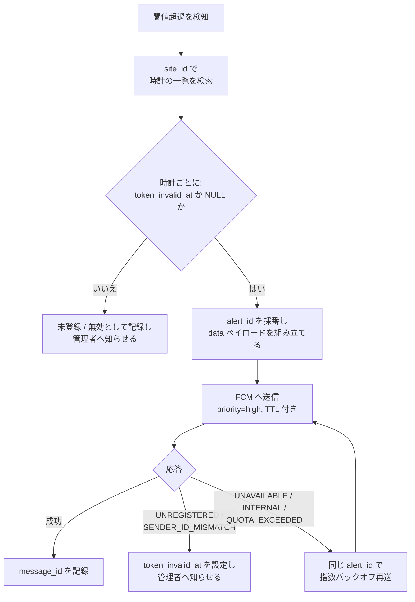

# バックエンド仕様書（DB / API / 通知送信）

作成日: 2026-10-19  
バージョン: 0.3.0（時計ごとの登録と現場単位の通知。D-07、D-14）  
元資料: [00-original-direction.md](00-original-direction.md) §3  
対象: 既存の DB 監視システムへの追加分（テーブル、登録 API、通知送信処理）  
参考実装: [`backend/`](../backend/)（Python / FastAPI / SQLite）

## 1. 概要

既存の DB 監視システムに次の 3 つを追加する。

| 追加物 | 役割 |
| --- | --- |
| `watch_devices` テーブル | 時計 1 台につき 1 行。どの現場に、どの端末番号で登録されているかと、最新の宛先 ID の対応表 |
| 登録 API | ウォッチから送られた登録内容を、その時計の行に UPSERT する |
| 通知送信処理 | 閾値超過時に、その現場に登録されている時計すべてへ FCM の `data` メッセージを優先度 `high` で送る |

既存システムの言語、DB 製品、ネットワーク配置は未確認のため（[D-09](06-risks-and-open-issues.md#2-要決定事項)）、本書では SQL を PostgreSQL と MySQL の両方で示す。動作確認用に、同じ仕様の参考実装（FastAPI ＋ SQLite）を `backend/` に置いた。既存システムへはこれを移植する。

変更: FCM の宛先は Firebase Installation ID（FID）とする（[R-20](06-risks-and-open-issues.md#3-技術リスク)）。原本の項目名 `fcm_token` は API・DB ともに残し、中身を FID とする。

変更（D-14）: 行の鍵を、作業員が入力する端末番号ではなく、時計本体の識別子 `watch_id` にした。端末番号は朝会後の貸し出しで毎日入力し直すもので、打ち間違えると別の時計と重なる。番号を鍵にすると、後から登録した時計が先の時計の行を上書きし、先の時計に通知が届かなくなる。時計ごとの行にすれば、登録で書き換わるのはその時計自身の行だけになる。

変更（D-07）: 通知は現場単位で送る。端末番号は貸し出し台帳と照らし合わせるための番号で、宛先の指定には使わない（テスト通知だけ番号で絞れる）。

表記は [02-wearos-app-spec.md §1.1](02-wearos-app-spec.md#11-表記) と同じく、無印が原本どおり、「補足」が本書で追加した仕様を表す。

## 2. DB テーブル

### 2.1 `watch_devices`

| カラム | 型 | 制約 | 内容 | 出典 |
| --- | --- | --- | --- | --- |
| `watch_id` | VARCHAR(64) | 主キー | 時計本体の識別子。アプリが自動で送る（Android の `ANDROID_ID`）。旧版アプリの行は `fid:` ＋宛先 ID | 変更（D-14） |
| `site_id` | INT | NOT NULL、索引 | 現場識別子。送信先を選ぶ鍵 | 原本 |
| `device_id` | INT | NOT NULL、索引 | 作業員が入力した端末番号。台帳との照合と表示用で、一意ではない | 原本（意味を変更） |
| `fcm_token` | VARCHAR(512) | NOT NULL | 最新の宛先 ID（FID）。UPSERT で上書きする | 原本（中身は変更） |
| `updated_at` | TIMESTAMP | NOT NULL | 最後に登録・更新された時刻 | 原本 |
| `app_version` | VARCHAR(32) | NULL 可 | アプリのバージョン。自動更新の進み具合の確認用 | 補足（任意） |
| `token_invalid_at` | TIMESTAMP | NULL 可 | FCM が無効と応答した時刻。再登録で NULL に戻す | 補足（任意） |

- FCM トークンの長さは仕様で固定されていないため、`VARCHAR(512)` 程度の余裕を持たせる（`TEXT` でもよい）。
- 補足: `fcm_token` には一意インデックスを張らず、§3.4 の手順で同じトークンの重複行を消す。
- 補足: `(site_id, device_id)` は一意にしない。同じ日に同じ番号の時計が 2 台あっても、両方の行を残して両方に送る。食い違いは登録の応答と一覧で知らせる（§3.3、§7）。
- 参考実装（SQLite）は、旧形式（主キーが `site_id` + `device_id`）の表を起動時に自動で移行する。

```sql
-- PostgreSQL
CREATE TABLE watch_devices (
    watch_id         VARCHAR(64)  PRIMARY KEY,
    site_id          INTEGER      NOT NULL,
    device_id        INTEGER      NOT NULL,
    fcm_token        VARCHAR(512) NOT NULL,
    updated_at       TIMESTAMPTZ  NOT NULL DEFAULT CURRENT_TIMESTAMP,
    app_version      VARCHAR(32),
    token_invalid_at TIMESTAMPTZ
);
CREATE INDEX idx_watch_devices_site ON watch_devices (site_id, device_id);
CREATE INDEX idx_watch_devices_fcm_token ON watch_devices (fcm_token);
```

```sql
-- MySQL 8.0
CREATE TABLE watch_devices (
    watch_id         VARCHAR(64)  NOT NULL,
    site_id          INT          NOT NULL,
    device_id        INT          NOT NULL,
    fcm_token        VARCHAR(512) NOT NULL,
    updated_at       TIMESTAMP    NOT NULL DEFAULT CURRENT_TIMESTAMP,
    app_version      VARCHAR(32)  NULL,
    token_invalid_at TIMESTAMP    NULL,
    PRIMARY KEY (watch_id),
    INDEX idx_watch_devices_site (site_id, device_id),
    INDEX idx_watch_devices_fcm_token (fcm_token)
);
```

## 3. 登録 API

### 3.1 エンドポイント

| 項目 | 内容 |
| --- | --- |
| メソッド / パス | `POST /api/register`（本番のドメインは未定。開発時は `http://127.0.0.1:8765`） |
| 通信 | HTTPS 必須 |
| 呼び出し元 | ウォッチのアプリ（登録ボタン押下時、アプリ起動時、トークン更新時） |
| 冪等性 | 同じ内容を何度送っても結果は同じ（UPSERT）。アプリは起動のたびに呼ぶ |
| 認証 | `X-Api-Key` ヘッダーの共有 API キー（[D-02](06-risks-and-open-issues.md#2-要決定事項)）。キーがない・違う場合は本文を検証する前に 401 を返す |
| 到達性 | 現場 Wi-Fi（インターネット）から到達できる必要がある。既存システムが社内ネットワークにある場合は公開経路を用意する（[D-09](06-risks-and-open-issues.md#2-要決定事項)） |

### 3.2 リクエスト

```http
POST /api/register HTTP/1.1
Content-Type: application/json
X-Api-Key: （共有 API キー）

{
  "site_id": 101,
  "device_id": 5,
  "fcm_token": "（Firebase Installation ID）",
  "watch_id": "6b095e56c9172205",
  "app_version": "0.2.0"
}
```

| 項目 | 型 | 必須 | 検証 |
| --- | --- | --- | --- |
| `site_id` | 整数 | 必須 | 範囲内の正の整数（暫定 1〜999999、[D-01](06-risks-and-open-issues.md#2-要決定事項)）。文字列の `"101"` は受け付けない |
| `device_id` | 整数 | 必須 | 範囲内の正の整数（暫定 1〜999） |
| `fcm_token` | 文字列 | 必須 | 空でない、空白を含まない、512 文字以内 |
| `app_version` | 文字列 | 任意 | 補足。32 文字以内 |
| `watch_id` | 文字列 | 任意 | 変更（D-14）。64 文字以内の英数字と `_.:-`。0.2.0 以降のアプリが送る。ない場合（旧版アプリ）は `fid:` ＋ `fcm_token` を鍵にする |

真偽値（`true`）も整数として受け付けない。

補足: 定義にない項目は無視する。自動更新で新旧アプリが混在する期間があるため、必須項目を後から増やさない（[R-10](06-risks-and-open-issues.md#3-技術リスク)）。

### 3.3 レスポンス

| ステータス | 条件 | 本文の例 |
| --- | --- | --- |
| 200 | 登録・更新に成功 | `{"status":"ok","site_id":101,"device_id":5,"updated_at":"2026-10-19T10:00:00+09:00","duplicate_count":0}` |
| 400 | 入力値の不備 | `{"status":"error","error":"invalid_device_id"}` |
| 401 | 認証の不備（[D-02](06-risks-and-open-issues.md#2-要決定事項) 採用時） | `{"status":"error","error":"unauthorized"}` |
| 500 | サーバー内部エラー | `{"status":"error","error":"internal"}` |

`duplicate_count` は、同じ業務日に同じ現場・同じ端末番号で登録した別の時計の数（D-14）。0 でなくても登録は成功で、どの時計にも通知は届く。アプリは「同じ番号の時計あり　台帳を確認」と表示する。業務日は既定で毎日 4 時（日本時間）に切り替わる（`SITEALERT_DAY_START_HOUR`、`SITEALERT_TIMEZONE`）。前の業務日の登録と番号が重なるのは貸し出しの入れ替えとして扱い、数えない。

アプリ側の扱いは [02-wearos-app-spec.md §4.4](02-wearos-app-spec.md#44-応答の扱い) を参照する。

### 3.4 登録処理

1. 入力値を検証する。`watch_id` がなければ `fid:` ＋ `fcm_token` を使う。
2. 補足: 同じ `fcm_token` が別の `watch_id` で登録済みなら、その行を削除する（[D-10](06-risks-and-open-issues.md#2-要決定事項)）。旧版アプリから更新した時計の古い行が残らないようにする。
3. `watch_id` をキーに UPSERT し、`site_id`、`device_id`、`fcm_token`、`updated_at` を上書きする。補足: `token_invalid_at` は NULL に戻す。**別の時計の行は変更しない。**
4. 補足: 同じ `site_id` と `device_id` を持つ別の時計のうち、業務日の開始以降に登録したものを数えて応答に入れる。

手順 2 と 3 は 1 つのトランザクションで行う。

```sql
-- PostgreSQL（$1 = watch_id, $2 = site_id, $3 = device_id, $4 = fcm_token, $5 = app_version, $6 = 業務日の開始）
BEGIN;

DELETE FROM watch_devices
 WHERE fcm_token = $4
   AND watch_id <> $1;

INSERT INTO watch_devices (watch_id, site_id, device_id, fcm_token, updated_at, app_version, token_invalid_at)
VALUES ($1, $2, $3, $4, CURRENT_TIMESTAMP, $5, NULL)
ON CONFLICT (watch_id) DO UPDATE
   SET site_id          = EXCLUDED.site_id,
       device_id        = EXCLUDED.device_id,
       fcm_token        = EXCLUDED.fcm_token,
       updated_at       = EXCLUDED.updated_at,
       app_version      = EXCLUDED.app_version,
       token_invalid_at = NULL;

COMMIT;

-- 同じ業務日の重複（応答の duplicate_count）
SELECT count(*) FROM watch_devices
 WHERE site_id = $2 AND device_id = $3 AND watch_id <> $1 AND updated_at >= $6;
```

```sql
-- MySQL 8.0.19 以降（行エイリアス構文）
INSERT INTO watch_devices (watch_id, site_id, device_id, fcm_token, updated_at, app_version, token_invalid_at)
VALUES (?, ?, ?, ?, CURRENT_TIMESTAMP, ?, NULL) AS new
ON DUPLICATE KEY UPDATE
    site_id          = new.site_id,
    device_id        = new.device_id,
    fcm_token        = new.fcm_token,
    updated_at       = new.updated_at,
    app_version      = new.app_version,
    token_invalid_at = NULL;
```

## 4. 通知送信処理（閾値超過時）

### 4.1 呼び出し口

既存の監視処理から呼ぶ関数（または内部 API）を 1 つ用意する。

```text
notify_site(site_id, title, body) -> 送信結果（全体の状態と、時計ごとの結果）
```

- 変更（D-07）: 現場に登録されている時計すべてへ送る。同じ `alert_id` を全台に使う。
- 全体の状態は `sent`（全台について FCM が送信を受け付けた）、`partial`（一部だけ）、`failed`（1 台も送れない）、`not_registered`（その現場に時計がない）。`sent` 以外は管理者へ知らせる。`sent` は時計への到達や作業員の確認を意味しない（受信確認は D-05）。
- 1 台の失敗で他の時計への送信を止めない。
- テスト通知用に、端末番号で絞る指定（`device_id`）も受け付ける。同じ番号の時計が複数あれば、すべてに送る。`type = alert` と `device_id` の併用は送信前に拒否する。CLI は設定・DB・Firebase の初期化前に終了コード 2 で終了し、`notify_site` は `ValueError` を送出する。
- 閾値を超えた状態が続く間の再通知の間隔は、既存の監視システムの警報ルールに合わせる（[D-11](06-risks-and-open-issues.md#2-要決定事項)）。

### 4.2 処理フロー



1. 対象の `site_id` に登録されている時計の行を検索する。行がなければ未登録として管理者へ知らせる。
2. 時計ごとに、Firebase Admin SDK（または HTTP v1 API）を用いて、その宛先 ID 宛てに通知ペイロードを送信する。
3. **送信時は `notification` ではなく `data` ペイロード（優先度: `high`）として送信する。** 時計がスリープ中でもアプリの受信処理を確実に起動するためである。`notification` を含めると、アプリがバックグラウンドの時に OS が通知を表示してしまい、アプリ独自の振動・画面点灯が動かない。

### 4.3 送信ペイロード

FCM HTTP v1 API の形式で示す。

```http
POST https://fcm.googleapis.com/v1/projects/{PROJECT_ID}/messages:send
Authorization: Bearer {OAuth 2.0 アクセストークン}
Content-Type: application/json
```

```json
{
  "message": {
    "fid": "（Firebase Installation ID）",
    "data": {
      "type": "alert",
      "alert_id": "3f6c2a1e-7d4b-4e7a-9c1b-2a5e8f0d1c3b",
      "site_id": "101",
      "device_id": "5",
      "title": "警告",
      "body": "測定値が閾値を超えました",
      "sent_at": "2026-10-19T10:15:00+09:00"
    },
    "android": {
      "priority": "high",
      "ttl": "300s"
    }
  }
}
```

| キー | 内容 | 出典 |
| --- | --- | --- |
| `type` | `alert`（警告）/ `test`（鳴動確認） | 補足 |
| `alert_id` | 警告 1 件ごとの UUID。再送時も同じ値を使い、アプリ側で重複表示を防ぐ | 補足 |
| `site_id` / `device_id` | 受け取る時計の現場と端末番号。アプリ側の照合とログ用 | 補足 |
| `title` / `body` | 警告メッセージ。時計の画面に収まるよう `body` は 40 文字程度までとする | 補足 |
| `sent_at` | 送信時刻（ISO 8601） | 補足 |
| `android.priority` | `high`。スリープ中の端末を起こす | 原本 |
| `android.ttl` | 届かなかった時に FCM が保持する時間。暫定 300 秒（[D-06](06-risks-and-open-issues.md#2-要決定事項)） | 補足 |

- 変更: 宛先は `token` 欄ではなく `fid` 欄に入れる。`token` 欄は非推奨になった（移行期間中は FID も受け付ける）。
- `data` の値はすべて文字列にする（数値も `"101"` のように文字列化する）。
- ペイロード全体は 4KB 以内に収める。
- 補足: 高優先度メッセージを受け取った端末が通知を表示しないことが続くと、FCM が優先度を下げることがある。テスト送信を含め、`high` で送るメッセージは必ず通知として表示する（[R-14](06-risks-and-open-issues.md#3-技術リスク)）。

### 4.4 送信コード例（Python / Firebase Admin SDK）

参考実装は [`backend/sitealert_backend/notifier.py`](../backend/sitealert_backend/notifier.py)。Java、Node.js、Go の Admin SDK でも同じ構成で書ける（いずれも `fid` を指定できる）。

```python
import uuid
from datetime import datetime, timedelta, timezone

import firebase_admin
from firebase_admin import exceptions, messaging

firebase_admin.initialize_app()  # GOOGLE_APPLICATION_CREDENTIALS またはデフォルト認証情報を使う

JST = timezone(timedelta(hours=9))


def send_alert(fcm_token: str, site_id: int, device_id: int, title: str, body: str,
               alert_id: str | None = None) -> str:
    message = messaging.Message(
        fid=fcm_token,  # 中身は FID
        data={
            "type": "alert",
            "alert_id": alert_id or str(uuid.uuid4()),
            "site_id": str(site_id),
            "device_id": str(device_id),
            "title": title,
            "body": body,
            "sent_at": datetime.now(JST).isoformat(timespec="seconds"),
        },
        android=messaging.AndroidConfig(priority="high", ttl=timedelta(seconds=300)),
    )
    return messaging.send(message)  # 成功時は message_id


# 例外の扱い
#   messaging.UnregisteredError / messaging.SenderIdMismatchError
#       -> token_invalid_at を設定し、管理者へ知らせる（再送しない）
#   exceptions.UnavailableError / exceptions.InternalError / messaging.QuotaExceededError
#       -> 同じ alert_id で指数バックオフ再送（TTL を超えない範囲で最大 3 回）
#   exceptions.InvalidArgumentError
#       -> ペイロードかトークンの不備。記録して管理者へ知らせる
```

### 4.5 エラー処理

| FCM のエラー | HTTP | 意味 | 対応 |
| --- | --- | --- | --- |
| `UNREGISTERED` | 404 | トークンが無効（アンインストール、データ削除など） | `token_invalid_at` を設定。端末の再登録が必要と管理者へ知らせる |
| `SENDER_ID_MISMATCH` | 403 | 別の Firebase プロジェクトのトークン | 同上 |
| `INVALID_ARGUMENT` | 400 | ペイロードやトークン形式の不備 | 記録して調査する。再送しない |
| `QUOTA_EXCEEDED` | 429 | 送信数の上限超過 | `Retry-After` に従い再送する |
| `UNAVAILABLE` | 503 | FCM の一時的な障害 | 指数バックオフで再送する |
| `INTERNAL` | 500 | FCM の内部エラー | 指数バックオフで再送する |

補足（2026-10-21）: `notify_site` の開始から TTL 秒を現場全体の送信期限とし、単調時計で経過時間を測る。時計ごとの各送信試行には残り時間を FCM の TTL として渡す。再送の待機後に期限へ達する場合は待機せず、その時計を `failed` / `error: ttl_expired` として後続の時計へ進む。送信前や待機後に既に期限が過ぎている場合も送らない。`attempts` は実際の送信関数の呼び出し回数で、初回送信前の期限切れは 0。

この期限管理は同じ `notify_site` 呼び出し内の自動再送が対象。実行中の SDK 通信を中断するものではなく、別の呼び出しや CLI の再実行では、同じ `alert_id` を渡しても期限を引き継がない。

## 5. 認証情報と通信要件

| 項目 | 内容 |
| --- | --- |
| FCM 送信の認証 | Firebase プロジェクトのサービスアカウントで OAuth 2.0 アクセストークンを取得する。Admin SDK を使えば自動で行われる |
| 鍵の保管 | サービスアカウント鍵（JSON）はリポジトリに含めない。シークレット管理の仕組みか、権限を絞ったサーバー上のファイルで保管する。Google Cloud 上で動かす場合は鍵ファイルを使わずデフォルト認証情報を使う |
| 権限 | FCM 送信に必要な最小のロールに絞る |
| 外向き通信 | バックエンドから `oauth2.googleapis.com` と `fcm.googleapis.com` へ HTTPS で到達できること。名前解決できることも確認する（開発環境では VPN の DNS が `fcm.googleapis.com` を解決しなかった。[R-21](06-risks-and-open-issues.md#3-技術リスク)） |
| 開発時の認証 | 鍵ファイルを作らず、送信専用サービスアカウント `fcm-sender` の権限を gcloud で借りる（`SITEALERT_FCM_TOKEN_COMMAND`）。`fcm-sender` には `roles/firebasecloudmessaging.admin` だけを付けている |
| 内向き通信 | 現場 Wi-Fi から登録 API へ HTTPS で到達できること |

## 6. ログと監視（補足）

| 対象 | 記録・監視内容 |
| --- | --- |
| 登録 API | 受付日時、`watch_id`、`site_id`、`device_id`、`app_version`、結果。`watch_id` とトークンは先頭と末尾の数文字だけを記録し、全量を残さない。同じ業務日の番号の重複は警告として記録する |
| 通知送信 | `alert_id`、時計ごとの宛先、送信日時、FCM の `message_id` またはエラー種別、再送回数、現場全体の送信台数 |
| 未登録・無効端末 | 宛先が見つからない、または無効になった場合は既存の監視の警報経路で管理者へ知らせる |
| 配信状況 | `app_version` ごとの台数を集計し、自動更新の進み具合を確認する |
| 生存確認 | `updated_at` はアプリ起動とトークン更新の時にしか変わらないため、端末が動いているかの判定には使えない。必要なら定期的な再登録を追加する（[D-12](06-risks-and-open-issues.md#2-要決定事項)） |

## 7. テスト送信手段（補足）

キッティング時と現場導入時に鳴動を確かめるため、管理者用コマンドを用意した。

```bash
cd backend
set -a && . ./.env && set +a              # 開発用の設定（Git 管理外）
.venv/bin/python -m sitealert_backend.cli devices --site 101                    # 現場の時計の一覧（番号が重なる行は duplicate: true）
.venv/bin/python -m sitealert_backend.cli send --site 101 --device 5            # 端末番号 5 の時計へテスト通知
.venv/bin/python -m sitealert_backend.cli send --site 101 --type alert \
    --title "警告: 閾値超過" --body "測定値が閾値を超えました"                   # 現場の全台へ警告
.venv/bin/python -m sitealert_backend.cli send --site 101 --dry-run             # FCM で形式だけ検証
.venv/bin/python -m sitealert_backend.cli remove --watch <watch_id>             # 返却・紛失した時計を外す
```

時計の行は、その時計が登録し直すまで残る。返却して保管している時計にも現場の通知が届くため、紛失や長期保管の時は `remove` で外す（[04 §5](04-operations-runbook.md#5-端末の番号変更交換紛失補足)）。

設定は環境変数で渡す（`SITEALERT_API_KEY`、`SITEALERT_DB_PATH`、`FIREBASE_PROJECT_ID`、`SITEALERT_FCM_TOKEN_COMMAND`、`SITEALERT_FCM_TTL_SECONDS`、`SITEALERT_DAY_START_HOUR`、`SITEALERT_TIMEZONE`）。手順は [04-operations-runbook.md](04-operations-runbook.md) を参照する。

## 8. テスト

`backend/` で `.venv/bin/python -m pytest` を実行する。2026-10-19 時点で 51 件すべて成功。登録 API の検証・認証、時計ごとの UPSERT、同じ番号の別の時計の行を残すこと、業務日内の重複の検出、旧形式の表の移行、現場単位の送信（1 台の失敗で止まらないこと）、送信ペイロード（`fid`・`data` のみ・`high`・TTL）、エラー種別ごとの無効化と再送を確かめている。

2026-10-21 は計 59 件が成功。通常警報の端末絞り込みの拒否、再送・後続端末での TTL 減少、期限以上の `Retry-After`、送信中や待機中に期限を越えるケースを追加した。時間と FCM 送信を模擬した検証で、実際の FCM 送信は行っていない。
